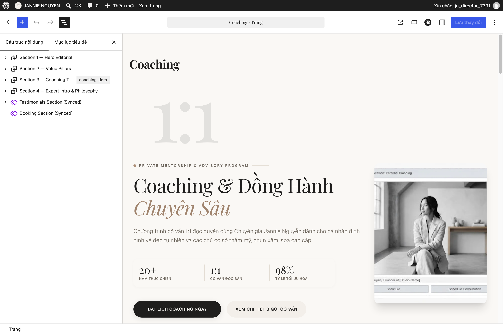
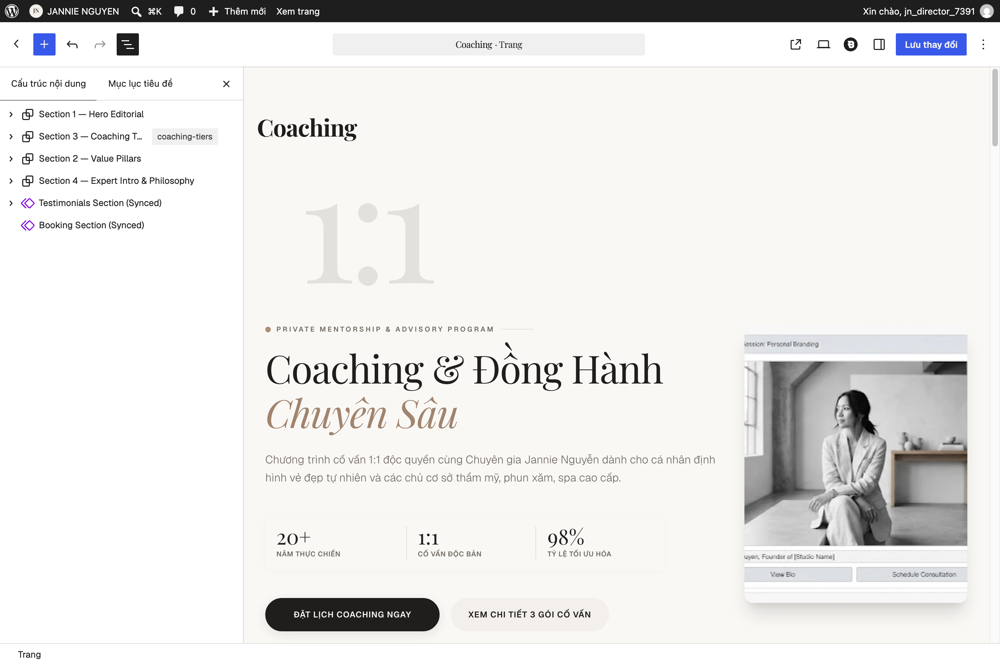
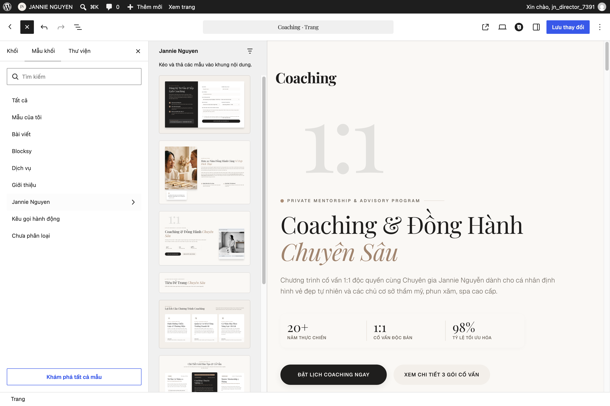

# 01 — Hướng Dẫn Chỉnh Sửa Trang & Hình Ảnh Trong Gutenberg

Website Jannie Nguyễn được xây dựng hoàn toàn bằng trình soạn thảo khối gốc (**Gutenberg Block Editor**) kết hợp bộ mẫu thiết kế độc quyền (**Patterns `Jannie Nguyen`**). Bạn có thể tự thay đổi câu chữ, đổi thứ tự các phần hoặc thay ảnh mới mà không lo làm vỡ bố cục hay lệch màu sắc.

---

## 1. Mở Trang Cần Chỉnh Sửa & Bật "Xem Danh Sách" (`List View`)

1. Đăng nhập vào cổng quản trị `/<WP_LOGIN_SLUG>`.
2. Ở thanh menu bên trái, chọn **Trang (`Pages`) → Tất cả các trang (`All Pages`)**.
3. Di chuột vào trang muốn sửa (ví dụ: **Coaching**, **Home**, **My Story**) và bấm **Chỉnh sửa (`Edit`)**.
4. Ở góc trên cùng bên trái của màn hình soạn thảo, bấm vào biểu tượng **3 vạch ngang lệch (`Document Overview / List View`)** để mở cây cấu trúc các phân đoạn của trang.

---

## 2. Kéo Thả Sắp Xếp Thứ Tự Các Phân Đoạn (`Drag & Drop Sections`)

- Trong cột **Xem danh sách (`List View`)** bên trái, mỗi phân đoạn lớn của trang được đặt trong một khối **Nhóm (`Group`)** cấp cao nhất.
- Để đổi vị trí một phân đoạn:
  1. Nhấp giữ chuột vào tên khối **Nhóm (`Group`)** đó trong cột **List View** (hoặc dùng nút mũi tên **Lên / Xuống** trên thanh công cụ nổi).
  2. Kéo phân đoạn tới vị trí mong muốn rồi thả chuột.
  3. Bấm nút **Lưu (`Save` / `Update`)** ở góc trên bên phải.

> **Mẹo an toàn:** Một số cụm chi tiết nhỏ (như thanh 3 con số thống kê ở đầu trang hoặc huy hiệu thời lượng gói) đã được khóa bảo vệ cấu trúc (`Content-Only Lock`) để bạn có thể bấm vào sửa chữ bên trong thoải mái mà không vô tình xóa mất khung viền trang trí.

---

## 3. Chèn Thêm Mẫu Thiết Kế Có Sẵn (`Insert Jannie Nguyen Patterns`)

Khi tạo một trang mới hoặc muốn thêm một phân đoạn chuẩn phong cách thương hiệu:

1. Bấm nút dấu cộng màu đen **`[ + ]` (`Toggle block inserter`)** ở góc trên cùng bên trái.
2. Chuyển sang tab **Mẫu (`Patterns`)**.
3. Chọn danh mục **`Jannie Nguyen`**.
4. Nhấp vào mẫu bạn muốn thêm (ví dụ: *Hero Editorial*, *3 Trụ cột giá trị*, *Bảng 3 gói Coaching*, *Giới thiệu Chuyên gia*, *Cảm nhận học viên*, *Khung Đặt lịch*): mẫu sẽ được chèn ngay vào trang với đúng phông chữ, khoảng cách và bảng màu chuẩn.

---

## 4. Thay Thế Hình Ảnh & Quy Tắc Chuẩn Bị Ảnh (`<= 2000 px`)

### Bước 4.1 — Quy tắc vàng trước khi tải ảnh lên: Thu nhỏ chiều rộng/cao về `<= 2000 px`
- Máy ảnh chuyên nghiệp thường xuất file ảnh gốc rất nặng (`5000–8000 px`, `10–25 MB`).
- **Trước khi tải ảnh lên website**, hãy mở ảnh bằng công cụ **Preview** (trên máy Mac) hoặc **Photos / Squoosh.app** và giảm cạnh dài nhất của ảnh xuống **tối đa `2000 px`** (gợi ý kích thước chuẩn):
  - **Ảnh chân dung Hero đầu trang (tỷ lệ `4:5`):** `800 × 1000 px` (hoặc `1200 × 1500 px`).
  - **Ảnh chuyên gia tư vấn (tỷ lệ `3:4`):** `750 × 1000 px` (hoặc `1200 × 1600 px`).
  - **Ảnh đại diện học viên (tỷ lệ `1:1` vuông):** `320 × 320 px` (hoặc `160 × 160 px`).
  - **Ảnh chia sẻ mạng xã hội (Open Graph):** `1200 × 630 px`.
- **Hệ thống tự động tối ưu:** Ngay khi bạn tải ảnh `.jpg`, `.png` hoặc `.webp` (`<= 2000 px`) lên, website sẽ **tự động cắt các kích thước đáp ứng và nén sang định dạng siêu nhẹ `AVIF` + `WebP`** (chỉ từ `5 KB – 20 KB`), giúp trang tải tức thì trên điện thoại.

### Bước 4.2 — Thao tác thay ảnh trong Gutenberg
1. Nhấp chuột vào bức ảnh cần thay trên trang.
2. Trên thanh công cụ nổi phía trên bức ảnh, bấm nút **Thay thế (`Replace`)**.
3. Chọn **Mở thư viện Media (`Open Media Library`)** hoặc **Tải lên (`Upload`)** để chọn bức ảnh thật từ máy tính.
4. Ở cột cài đặt bên phải (`Block` → `Image`), điền mô tả ngắn gọn có nghĩa bằng tiếng Việt vào ô **Văn bản thay thế (`Alt Text`)** (ví dụ: *"Chuyên gia Jannie Nguyễn tư vấn định hình chân mày phong thủy 1:1 tại Học viện"*).
5. Bấm **Lưu (`Update`)**.

---

## 5. Trang "Sản Phẩm Yêu Thích" (`/my-favorite-product/`) — Bản Nâng Cấp 2026-10-31

Trang gồm 3 mẫu thiết kế có thể chèn lại từ thư viện (**Jannie Nguyen**): *My Favorite Product — Hero & Marquee*, *Giới thiệu & Bộ sưu tập*, *Manifesto*. Mọi chữ sửa trực tiếp trên trang như các khối thường; 3 khối đặc biệt sửa ở **thanh bên phải** (`Settings`) khi bấm chọn khối:

| Khối | Sửa được gì |
| :--- | :--- |
| **JN Product Stage** (minh họa 3 chai ở hero) | Mô tả cho trình đọc màn hình, dòng chữ viết tay ("a little luxury ✦"), dòng thương hiệu và tên 3 chai. Đây là hình minh họa trang trí, không phải ảnh sản phẩm. |
| **JN Marquee** (dải chữ chạy) | Các cụm chữ (mỗi dòng một cụm) và ngôn ngữ của chúng (`en`/`vi`). Nút tạm dừng luôn đi kèm, không xoá được — đây là yêu cầu trợ năng. |
| **JN Product Actions** (nút trên thẻ sản phẩm & nút "Kết Nối Với Jannie") | Nhãn nút "Mua Ngay" / "Xem sản phẩm" / nút liên hệ. Thứ tự nút tự theo giá: sản phẩm có giá → "Mua Ngay" trước; không có giá → nút tư vấn trước. |

- **Tên, ảnh, giá, mô tả ngắn trên thẻ** lấy từ **WooCommerce → Sản phẩm** (ô *Mô tả ngắn của sản phẩm*). Mô tả dài (tab *Mô tả* trên trang sản phẩm) là nội dung gốc jannieedu.com.
- **Đổi số Zalo** (nút "Tư vấn qua Zalo" và "Mở Zalo"): nhờ kỹ thuật chạy `wp option update jn_contact_zalo_url https://zalo.me/<số-mới>` rồi xoá bộ nhớ đệm trang. Nếu xoá option này, nút tự đổi thành "Nhận tư vấn" và hộp thoại chuyển sang gửi email `contact@jannienguyen.vn`.
- Sau khi sửa trang, bấm **Cập nhật** rồi xoá bộ nhớ đệm (WP Super Cache) để khách thấy bản mới.
- **Số Hotline / số điện thoại trong dữ liệu có cấu trúc** (demo: `0559 912 642`): hộp *Hotline Hỗ Trợ Khẩn* là khối đồng bộ — sửa một lần ở **Giao diện → Mẫu (Patterns) → Mẫu đã đồng bộ** là đổi trên mọi trang; số trong schema đổi bằng `wp option update jn_brand_telephone "+84 …"`.
