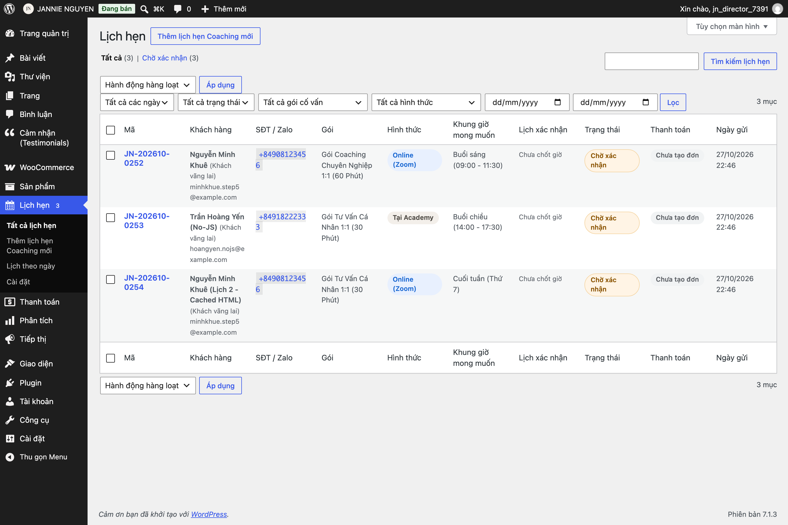
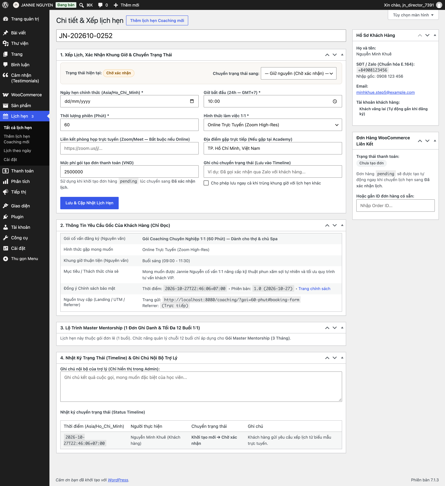
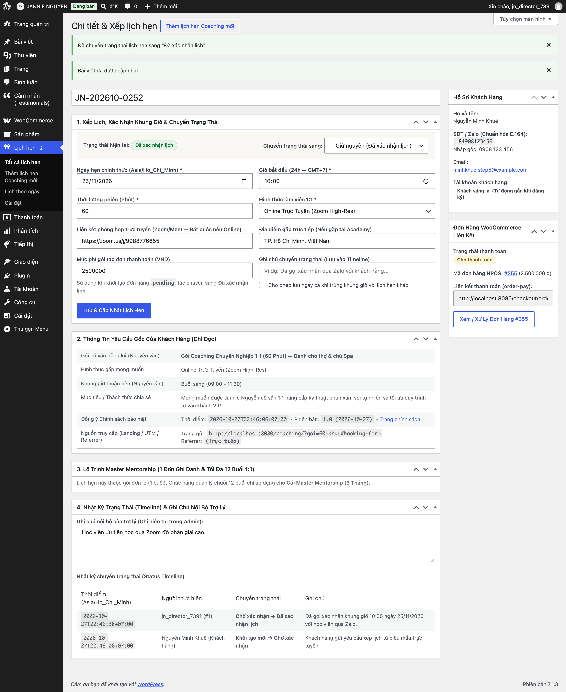
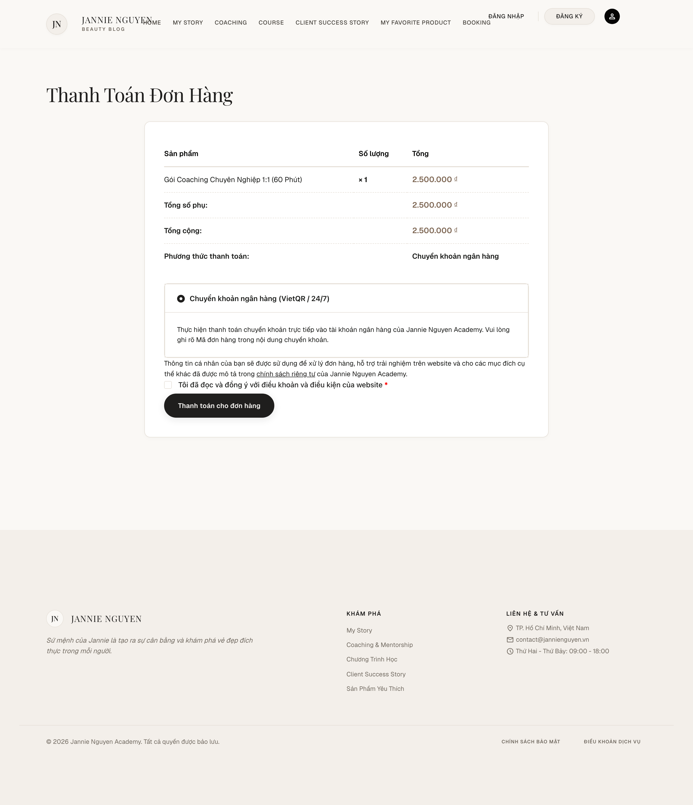
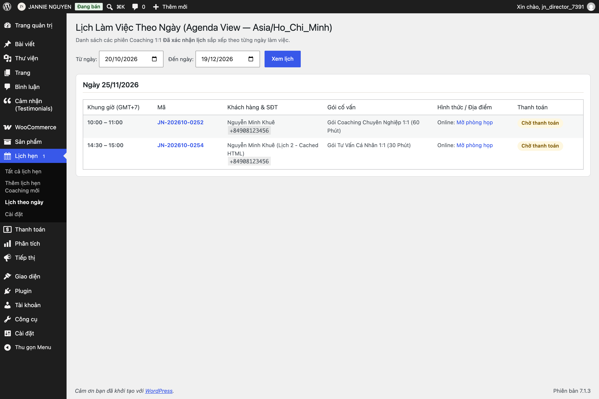
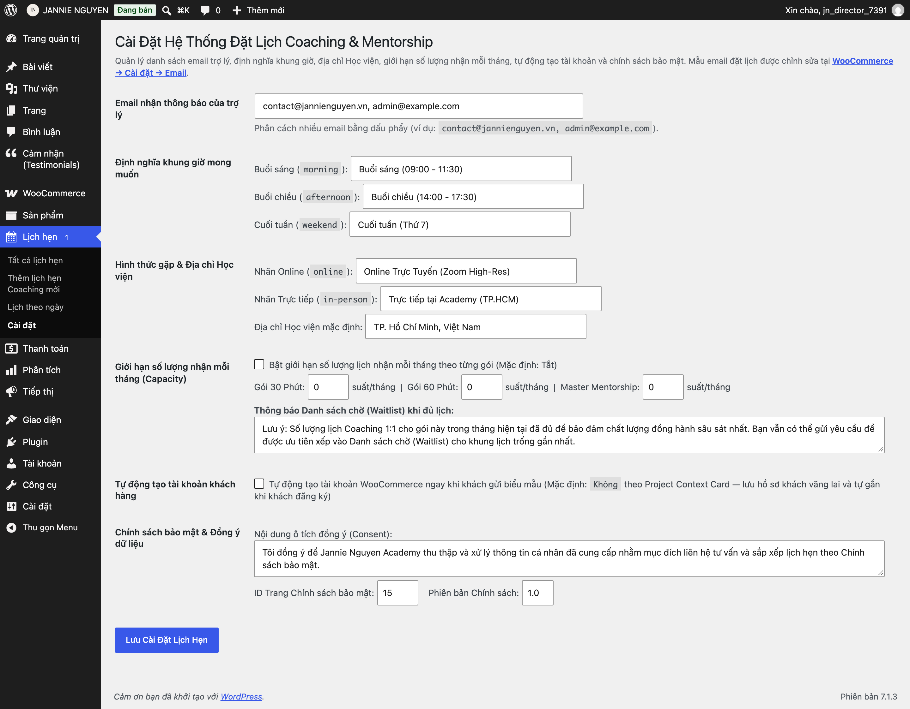

# 02 — Quản Lý Lịch Hẹn Coaching & Gửi Liên Kết Thanh Toán

Mọi yêu cầu tư vấn từ khách hàng trên website đều được tập trung tại mục **Lịch hẹn** trong trang quản trị. Theo chính sách của Học viện, **khách hàng chỉ thanh toán sau khi Trợ lý đã liên hệ xác nhận khung giờ trống**.

---

## 1. Sơ Đồ 5 Trạng Thái Lịch Hẹn

Mỗi lịch hẹn tuân theo quy trình 5 trạng thái chặt chẽ:

1. **`Chờ xác nhận` (`jn_pending`):** Khách vừa gửi biểu mẫu trên website (hoặc trợ lý vừa tạo mới).
2. **`Đã xác nhận lịch` (`jn_confirmed`):** Trợ lý đã gọi điện/Zalo chốt ngày giờ với khách. Hệ thống tự động tạo đơn hàng và gửi email xác nhận kèm lịch hẹn `.ics` + nút thanh toán.
3. **`Hoàn thành` (`jn_completed`):** Buổi Coaching 1:1 đã diễn ra thành công.
4. **`Vắng mặt` (`jn_no_show`):** Khách không tham gia buổi hẹn đã chốt.
5. **`Đã hủy` (`jn_cancelled`):** Lịch hẹn bị hủy (chỉ áp dụng cho lịch chưa kết thúc).

---

## 2. Quy Trình Xác Nhận Lịch Hẹn, Tạo Đơn Hàng & Gửi Link Thanh Toán

Khi có yêu cầu mới (menu **Lịch hẹn** hiện con số thông báo màu đỏ):

### Bước 1 — Mở hồ sơ yêu cầu & Liên hệ khách hàng
1. Vào **Lịch hẹn → Tất cả lịch hẹn**, bấm vào mã lịch hẹn đang ở trạng thái **`Chờ xác nhận`**.
2. Xem thông tin **Khách hàng**, **Số điện thoại / Zalo**, **Gói đăng ký**, **Khung giờ mong muốn** và **Mục tiêu / Thách thức** khách đã chia sẻ.
3. Liên hệ với khách qua Điện thoại / Zalo để thống nhất ngày giờ cụ thể và mức phí.

### Bước 2 — Chốt ngày giờ, Tạo đơn hàng tự động & Gửi link thanh toán (`order-pay`)
Tại hộp **Xếp lịch & Chuyển trạng thái**:
1. **Ngày & Giờ bắt đầu xác nhận:** Chọn đúng ngày và giờ theo múi giờ Việt Nam (`Asia/Ho_Chi_Minh`).
   - *Lưu ý:* Nếu khung giờ này trùng với một buổi Coaching đã xác nhận khác của Jannie Nguyễn, hệ thống sẽ hiện **cảnh báo trùng lịch** ngay lập tức để trợ lý đổi giờ khác.
2. **Thời lượng (phút):** Mặc định tự điền theo gói (`30` hoặc `60` phút).
3. **Liên kết phòng họp (Online) / Địa điểm (Trực tiếp):** Dán link Zoom/Google Meet hoặc địa chỉ phòng tư vấn tại Học viện.
4. **Mức phí đơn hàng (VND):** Nhập số tiền thỏa thuận (hoặc để hệ thống lấy theo giá gói).
5. **Trạng thái mới:** Chọn **`Đã xác nhận lịch`**.
6. Bấm nút **`Cập nhật lịch hẹn`**.

**Hệ thống sẽ tự động thực hiện ngay lập tức:**
- Khởi tạo một **Đơn hàng WooCommerce** ở trạng thái `Chờ thanh toán (Pending payment)` gắn kết với lịch hẹn.
- Gửi **Email xác nhận lịch hẹn** mang thương hiệu Jannie Nguyễn tới hộp thư của khách hàng, bên trong có sẵn:
  - Tệp lịch mời **`.ics`** để khách bấm 1 lần thêm vào Apple Calendar / Google Calendar / Outlook.
  - Nút **`Thanh Toán Ngay`** dẫn thẳng tới trang thanh toán riêng tư (`order-pay`) của đơn hàng đó.

### Bước 3 — Gửi lại liên kết thanh toán qua Zalo (nếu khách cần)
- Trong hộp **Đơn hàng WooCommerce liên kết** ở cột phải của trang chi tiết lịch hẹn, bạn có thể bấm nút **Sao chép liên kết thanh toán (`order-pay`)** để gửi trực tiếp qua Zalo cho khách hàng.
- Khi khách bấm vào liên kết này, khách sẽ thấy trang thanh toán gọn gàng với hướng dẫn chuyển khoản ngân hàng của Học viện:

---

## 3. Xem Lịch Theo Ngày (`Agenda View`) & Quản Lý Lộ Trình 12 Buổi Mentorship

- **Lịch theo ngày:** Vào **Lịch hẹn → Lịch theo ngày** để xem toàn bộ các phiên tư vấn trong ngày/tuần được sắp xếp theo thứ tự thời gian giúp chuẩn bị phòng họp và tài liệu.

- **Gói Master Mentorship (3 Tháng — 12 buổi):**
  - Khi xác nhận lịch hẹn đầu tiên của gói *Master Mentorship (3 Tháng)*, hệ thống tạo **1 đơn hàng ghi danh gốc duy nhất**.
  - Trong trang chi tiết của lịch ghi danh gốc đó, bảng **Lộ trình 12 buổi Mentorship** cho phép trợ lý bấm tạo từng buổi hẹn con (từ Buổi 1 đến tối đa Buổi 12) mà **không tạo thêm đơn thu tiền mới**, dùng chung trạng thái thanh toán của đơn ghi danh gốc.

---

## 4. Cài Đặt Lịch Hẹn & Danh Sách Chờ (`Waitlist`)

Vào **Lịch hẹn → Cài đặt** (dành cho Quản trị viên & Quản lý cửa hàng) để điều chỉnh:
- Địa chỉ email nhận thông báo của đội ngũ trợ lý.
- Địa chỉ Học viện hiển thị trong tệp lịch `.ics`.
- **Giới hạn số lượng lịch mỗi tháng (Công suất tháng):** Đặt `0` nếu không giới hạn. Nếu đặt một con số cụ thể (ví dụ `10` suất/tháng cho gói Mentorship) và số lịch trong tháng đã đạt ngưỡng, biểu mẫu trên website sẽ tự động hiển thị thông báo **Danh sách chờ (Waitlist)** và gắn nhãn `[Waitlist]` cho yêu cầu mới.

