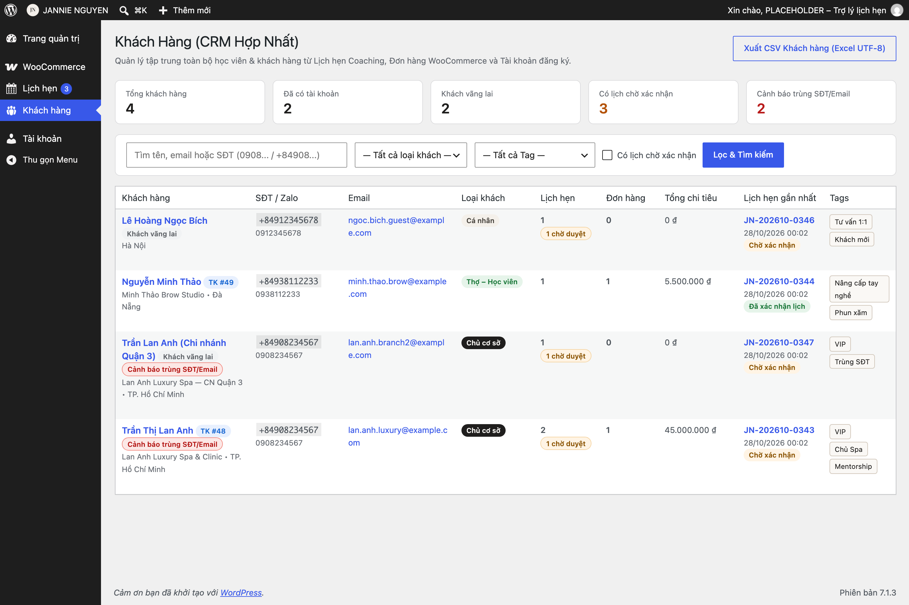
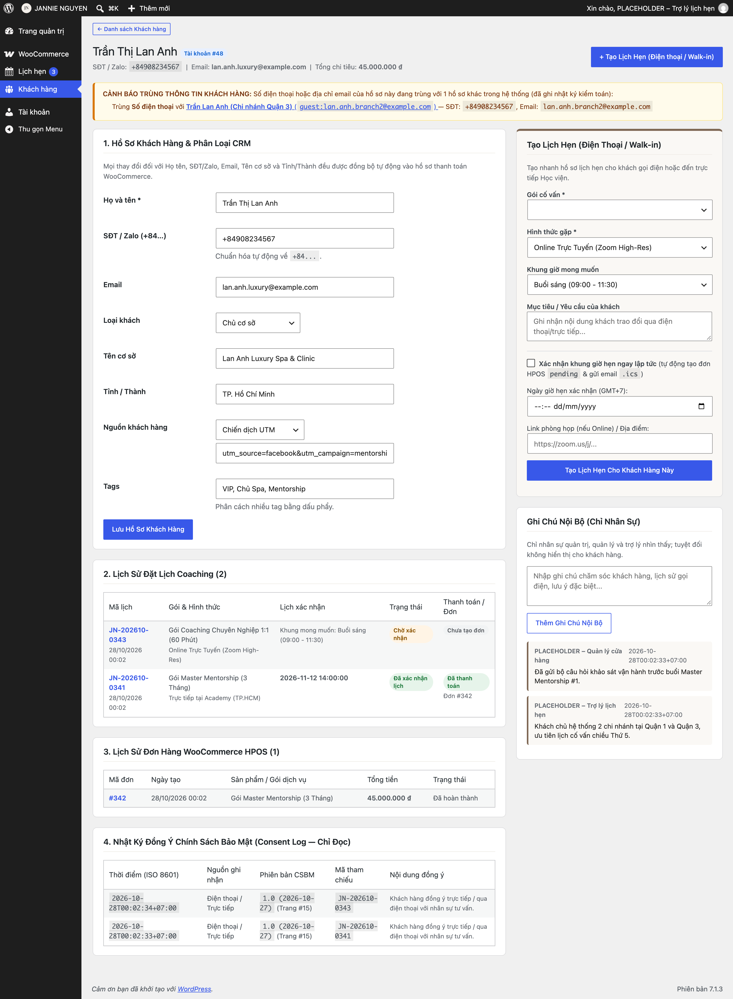
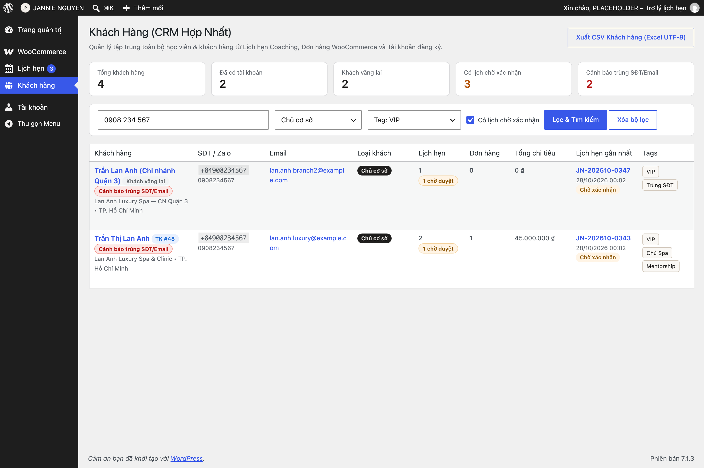

# 03 — Quản Lý Khách Hàng (CRM) & Xuất Dữ Liệu CSV Cho Excel

Mục **Khách hàng** trong trang quản trị hợp nhất toàn bộ học viên và khách hàng từ cả 3 nguồn: **Biểu mẫu đặt lịch Coaching**, **Đơn hàng tại cửa hàng** và **Tài khoản đăng ký thành viên**.

---

## 1. Tra Cứu & Lọc Danh Sách Khách Hàng

1. Truy cập menu **Khách hàng** ở cột bên trái trang quản trị.
2. **Tìm kiếm thông minh:** Bạn có thể gõ vào ô tìm kiếm:
   - Họ tên khách hàng, tên Spa/Thẩm mỹ viện, hoặc địa chỉ Email.
   - **Số điện thoại ở bất kỳ cách viết nào:** dù bạn gõ `0908234567`, `+84908234567`, `84908234567` hay `0908 234 567`, hệ thống đều tự động hiểu và tìm ra đúng khách hàng.
3. **Bộ lọc chuyên sâu:**
   - Lọc theo **Loại khách:** `Cá nhân`, `Thợ – Học viên`, hoặc `Chủ cơ sở`.
   - Lọc theo **Tag (Nhãn phân loại)**.
   - Tích chọn **`Có lịch chờ xác nhận`** để lọc nhanh những khách hàng đang chờ trợ lý gọi điện xếp lịch.

---

## 2. Xem & Cập Nhật Hồ Sơ Chi Tiết Khách Hàng (10 Trường CRM)

Bấm vào tên một khách hàng (hoặc nút **Xem hồ sơ**) để mở trang chi tiết:

- **Cập nhật thông tin phân loại:** Chọn *Loại khách*, điền *Tên cơ sở (Spa/Academy)*, *Tỉnh/Thành phố*, *Nguồn khách* và gắn *Tags* (ngăn cách bằng dấu phẩy, ví dụ: `VIP, Phun xăm, Mentorship`). Mọi thay đổi sẽ tự động đồng bộ 2 chiều với hồ sơ thanh toán WooCommerce.
- **Ghi chú nội bộ (`Internal Notes`):** Lưu lại lịch sử tư vấn, đặc điểm kỹ thuật hoặc lưu ý riêng của học viên. *Ghi chú này chỉ hiển thị cho nhân sự nội bộ, tuyệt đối không bao giờ hiển thị cho khách hàng.*
- **Tạo lịch hẹn trực tiếp (`Walk-in / Điện thoại`):** Khi khách gọi hotline hoặc nhắn Zalo trực tiếp mà không điền form trên web, trợ lý có thể điền ngay khung **Tạo lịch hẹn nhanh** ngay trong hồ sơ khách hàng đó.
- **Cảnh báo trùng số điện thoại / email:** Nếu có 2 hồ sơ trùng số điện thoại hoặc email, hệ thống sẽ hiện hộp cảnh báo màu vàng trên đầu hồ sơ để nhân sự kiểm tra (hệ thống không tự ý gộp đè dữ liệu để tránh nhầm lẫn).

---

## 3. Xuất Báo Cáo CSV Chuẩn Tiếng Việt Cho Microsoft Excel

Dành cho **Quản trị viên**, **Quản lý cửa hàng** và **Trợ lý lịch hẹn**:

1. Tại trang danh sách **Khách hàng** (hoặc **Lịch hẹn**), chọn bộ lọc bạn muốn kết xuất (hoặc để trống nếu muốn xuất toàn bộ).
2. Bấm nút **`Xuất CSV Khách hàng`** (hoặc **`Xuất CSV Lịch hẹn`**) ở góc phải phía trên bảng.
3. Tệp `.csv` tải về đã được tích hợp sẵn mã **UTF-8 BOM** chuyên dụng cho tiếng Việt: bạn chỉ cần **nhấp đúp mở trực tiếp bằng Microsoft Excel** (trên cả Windows và macOS), toàn bộ dấu tiếng Việt sẽ hiển thị rõ nét 100% mà không bị lỗi phông chữ.

