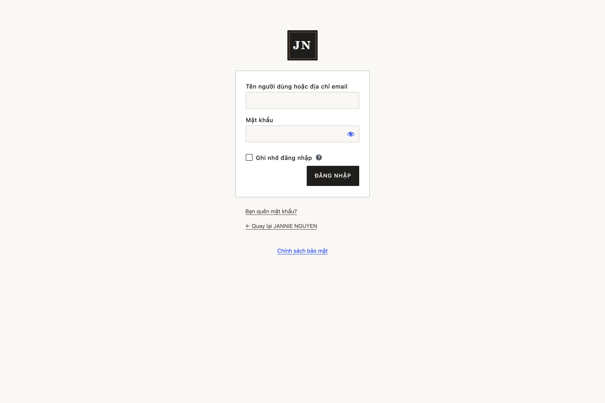
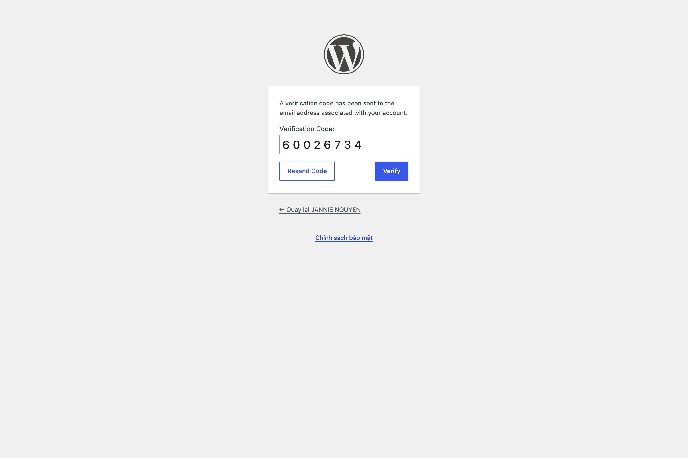

# 05 — Tài Khoản Nhân Sự, Phân Quyền & Bảo Mật 2 Lớp (`2FA`)

Để bảo vệ tuyệt đối dữ liệu khách hàng VIP và uy tín thương hiệu Jannie Nguyễn, hệ thống áp dụng cơ chế **phân quyền tối thiểu theo đúng chức trách** và **bắt buộc xác thực 2 lớp (`2FA`)** đối với toàn bộ nhân sự.

---

## 1. Cổng Đăng Nhập Riêng Biệt Cho Nhân Sự (`/<WP_LOGIN_SLUG>`)

- Nhân sự Học viện **chỉ đăng nhập tại đường dẫn riêng:**
  ```text
  https://<ten-mien-cua-ban>/<WP_LOGIN_SLUG>
  ```
  `<WP_LOGIN_SLUG>` là đường dẫn bí mật, **không ghi trong tài liệu**: quản trị viên nhận giá trị thật qua kênh bảo mật (biến `WP_LOGIN_SLUG` trong `.env.production` trên máy chủ). Muốn đổi đường dẫn, chỉ cần sửa biến này — không cần sửa mã nguồn hay cơ sở dữ liệu.
- Các đường dẫn mặc định của WordPress (`/wp-login.php`, `/wp-admin/`) đã được khóa ẩn và trả về trang `404` đối với người lạ.
- **Chống dò mật khẩu tự động (`Rate Limiting`):** Nếu một người nhập sai mật khẩu quá **5 lần liên tiếp trong vòng 15 phút**, hệ thống sẽ tự động khóa tạm thời cổng đăng nhập đối với địa chỉ IP/tài khoản đó trong 15 phút.



---

## 2. Bảng Phân Quyền 4 Vai Trò Nhân Sự

Mỗi thành viên trong đội ngũ được cấp một tài khoản riêng ứng với đúng công việc (tuyệt đối không dùng chung 1 tài khoản Quản trị):

| Vai trò nhân sự | Tài khoản mẫu bàn giao | Quyền hạn được phép | Giới hạn bảo mật |
| :--- | :--- | :--- | :--- |
| **1. Quản trị viên (`Administrator`)** | `<WP_ADMIN_USER>` | Toàn quyền quản lý hệ thống, cài đặt bảo mật, phân quyền nhân sự. | Bắt buộc 2FA. Chỉ dành cho Chủ sở hữu / Quản trị kỹ thuật. |
| **2. Quản lý cửa hàng (`Shop Manager`)** | `quan_ly_cua_hang` | Quản lý toàn bộ **Lịch hẹn**, **Khách hàng CRM**, **Cài đặt lịch hẹn**, **Đơn hàng & Sản phẩm WooCommerce**, **Xuất CSV**. | Bắt buộc 2FA. Không được cài/xóa plugin hay sửa tài khoản Quản trị. |
| **3. Trợ lý lịch hẹn (`Trợ lý lịch hẹn`)** | `tro_ly_lich_hen` | Xử lý **Lịch hẹn** (xác nhận lịch, tạo đơn, gửi link thanh toán), chăm sóc **Khách hàng CRM**, **Xuất CSV**. | Bắt buộc 2FA. Không được xóa lịch hẹn/khách hàng, không sửa sản phẩm hay cài đặt hệ thống. |
| **4. Biên tập nội dung (`Editor`)** | `bien_tap_noi_dung` | Chỉnh sửa nội dung các **Trang**, **Bài viết**, **Lời chứng thực** và **Thư viện hình ảnh**. | Bắt buộc 2FA. Không được xem dữ liệu Khách hàng CRM, Lịch hẹn hay Đơn hàng. |

> *(Chi tiết kỹ thuật về ma trận quyền hạn được lưu tại [`docs/jn/roles.md`](file:///Users/daugiabao/Documents/SUNEXT/Spa/Website/docs/jn/roles.md)).*

---

## 3. Hướng Dẫn Sử Dụng & Thiết Lập Xác Thực 2 Lớp (`2FA`)

### 3.1. Đăng nhập hàng ngày với 2FA
1. Nhập **Tên người dùng / Email** và **Mật khẩu** tại `/<WP_LOGIN_SLUG>`.
2. Hệ thống chuyển sang bước **Xác thực 2 lớp**:
   - **Cách 1 (Mặc định — Mã OTP qua Email):** Hệ thống gửi ngay 1 mã gồm 6 chữ số tới email công vụ của bạn. Nhập 6 số này vào ô **`Mã xác thực`** rồi bấm **Đăng nhập**.
   - **Cách 2 (Khuyến nghị — Ứng dụng Google Authenticator / Apple Passwords):** Mở ứng dụng trên điện thoại và nhập 6 số hiển thị trên màn hình.



### 3.2. Cách đổi sang email thật & cài đặt Google Authenticator cho nhân sự mới
1. **Quản trị viên** vào **Thành viên (`Users`) → Tất cả thành viên (`All Users`)**, bấm **Chỉnh sửa (`Edit`)** vào tài khoản nhân sự.
2. Cập nhật **Họ và tên**, **Email công vụ thật** và bấm **Đặt lại mật khẩu (`Send Reset Link`)**.
3. Sau khi nhân sự đăng nhập lần đầu, vào **Thành viên → Hồ sơ (`Profile`)**, kéo xuống mục **Tùy chọn Xác thực 2 lớp (`Two-Factor Options`)**:
   - Tích bật **Time Based One-Time Password (TOTP)** và dùng điện thoại quét mã QR.
   - Bấm **Tạo mã dự phòng (`Generate Backup Codes`)** và lưu 10 mã dự phòng vào nơi an toàn để dùng khi đi công tác không có sóng điện thoại.
