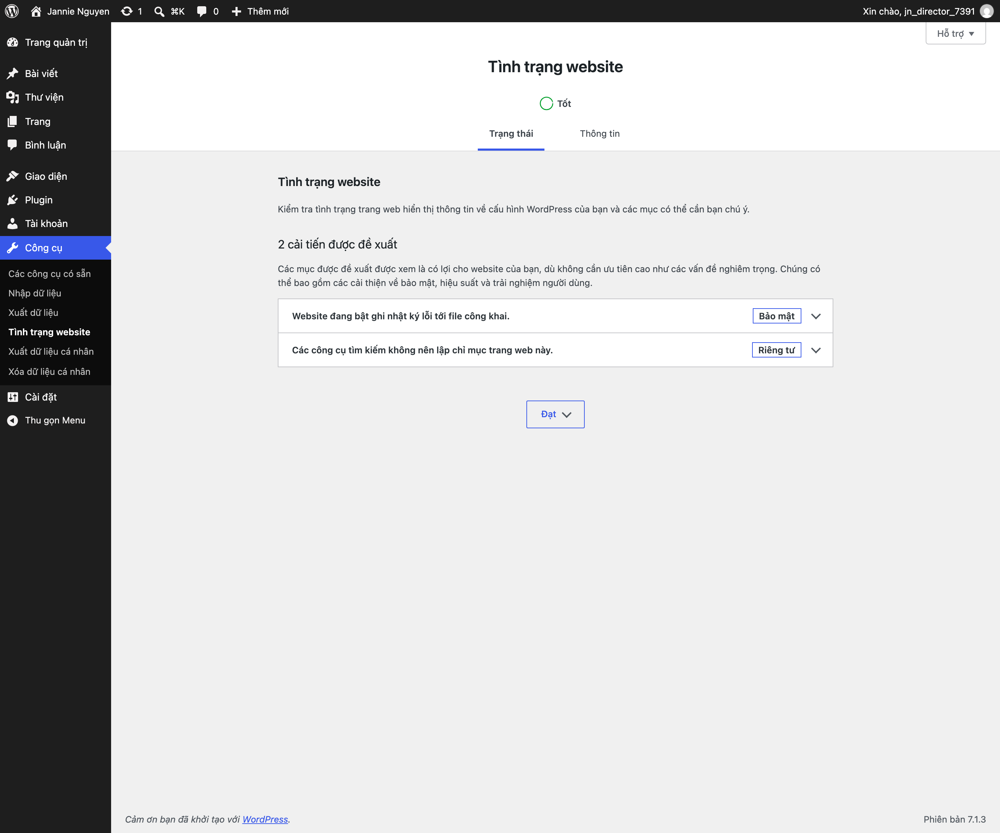
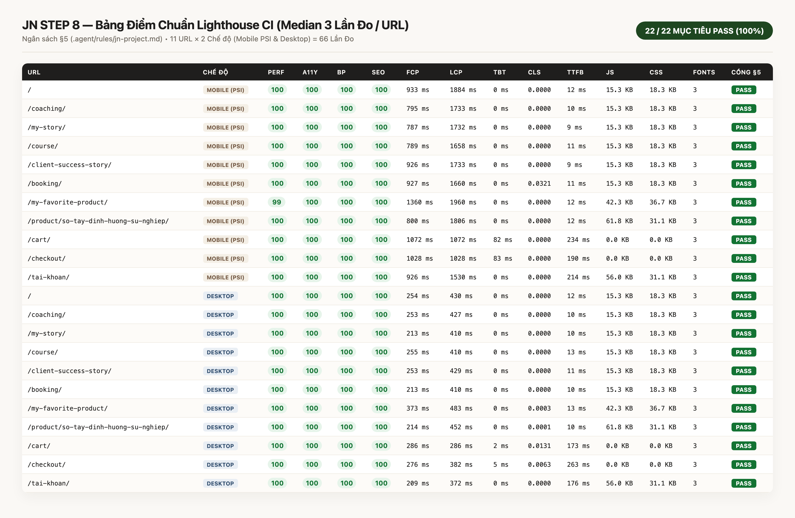

# 06 — Cập Nhật An Toàn, Sao Lưu Định Kỳ & Kiểm Tra PageSpeed Hàng Tháng

Để website luôn vận hành ổn định, bảo mật và giữ vững điểm tốc độ **99–100/100**, đội ngũ quản trị vui lòng thực hiện theo lịch bảo trì định kỳ dưới đây.

---

## 1. Quy Trình Cập Nhật Phần Mềm An Toàn (`Safe Updates — Staging First`)

WordPress, giao diện mẹ **Blocksy** và **WooCommerce** thường xuyên có các bản cập nhật bảo mật. **Tuyệt đối không bấm nút "Update Now" trực tiếp trên website đang chạy thật khi chưa kiểm tra.**

### Quy trình 4 bước chuẩn:
1. **Bước 1 — Chụp bản sao lưu trước khi chạm vào bất kỳ bản cập nhật nào:**
   - Chạy lệnh sao lưu cơ sở dữ liệu và mã nguồn (xem mục 2 bên dưới) hoặc bấm tạo Snapshot trên bảng điều khiển máy chủ (Hosting Control Panel).
2. **Bước 2 — Thử nghiệm trên môi trường Nháp (`Staging` / `Local`) trước:**
   - Thực hiện cập nhật trên bản Staging trước.
   - Mở kiểm tra bằng mắt trang **Coaching (`/coaching/`)**, thử chọn gói & gửi 1 yêu cầu đặt lịch mẫu, và kiểm tra trang **Thanh toán (`order-pay`)**.
3. **Bước 3 — Cập nhật trên môi trường Production vào khung giờ thấp điểm (sau 22:00):**
   - Chỉ cập nhật các plugin nằm trong danh mục được duyệt (`WooCommerce`, `WPS Hide Login`, `Two Factor`, `WP Super Cache`, `The SEO Framework`, `FluentSMTP`) và giao diện mẹ `Blocksy`.
   - Giao diện dự phòng **`Twenty Twenty-Five`** được giữ ở trạng thái **Không kích hoạt (`Inactive`)** làm phao cứu sinh khôi phục kỹ thuật — vẫn cập nhật bình thường nhưng không xóa và không kích hoạt.
4. **Bước 4 — Xóa bộ nhớ đệm và kiểm tra Tình trạng Website (`Site Health`):**
   - Sau khi cập nhật, vào **Cài đặt → WP Super Cache → Delete Cache** để làm mới bộ nhớ đệm.
   - Vào **Công cụ (`Tools`) → Tình trạng trang web (`Site Health`)** để xác nhận trạng thái **`Tốt` (`0` lỗi nghiêm trọng)**.

---

## 2. Lịch Sao Lưu Dữ Liệu (`Backup Schedule`)

- **Cơ sở dữ liệu (`Database` — chứa lịch hẹn, hồ sơ khách hàng CRM, đơn hàng):**
  - **Tự động hàng ngày (Daily):** Lưu tối thiểu **14 bản gần nhất** dưới dạng nén `.sql.gz` ở thư mục ngoài web root (`/var/www/PROD_DOMAIN/backups/`) và đồng bộ lên kho lưu trữ đám mây riêng của Học viện (Google Drive / S3 bảo mật).
- **Thư mục hình ảnh tải lên (`/media/`) & Mã nguồn (`/wordpress/`):**
  - **Tự động hàng tuần (Weekly)** và **trước mỗi lần cập nhật**.
- **Thử nghiệm khôi phục:** Mỗi quý 1 lần, nạp thử bản sao lưu vào môi trường Staging theo hướng dẫn trong [`docs/jn/deploy/runbook-trien-khai-va-rollback.md`](file:///Users/daugiabao/Documents/SUNEXT/Spa/Website/docs/jn/deploy/runbook-trien-khai-va-rollback.md) để đảm bảo bản sao lưu luôn sử dụng được.

---

## 3. Kiểm Tra Tốc Độ PageSpeed Insights Hàng Tháng (`Monthly PageSpeed Check`)

Vào ngày mùng 1 hàng tháng (hoặc sau khi thay đổi nhiều hình ảnh lớn trên trang), trợ lý dành 3 phút kiểm tra điểm tốc độ của website:

1. Truy cập công cụ chính thức của Google tại: **[https://pagespeed.web.dev/](https://pagespeed.web.dev/)**
2. Dán lần lượt đường dẫn **Trang chủ (`/`)** và trang **Coaching (`/coaching/`)** rồi bấm **Phân tích (`Analyze`)**.
3. **Chỉ tiêu cần đạt (cả Điện thoại `Mobile` và Máy tính `Desktop`):**
   - **Hiệu suất (`Performance`):** `>= 95` trên Mobile, `>= 98` trên Desktop.
   - **Khả năng tiếp cận (`Accessibility`), Phương pháp hay nhất (`Best Practices`), SEO:** `100 / 100`.
   - **Thời gian hiển thị nội dung lớn nhất (`LCP`):** `<= 2.0 giây`.

> **Nếu thấy điểm Hiệu suất giảm xuống dưới 95:** Nguyên nhân phổ biến nhất (99% trường hợp) là do vừa tải lên một bức ảnh chưa được thu nhỏ kích thước (`> 2000 px`). Hãy kiểm tra bức ảnh mới tải lên và thay lại theo đúng hướng dẫn tại [Bài 01 — Mục 4](./01-chinh-sua-trang-gutenberg.md).
